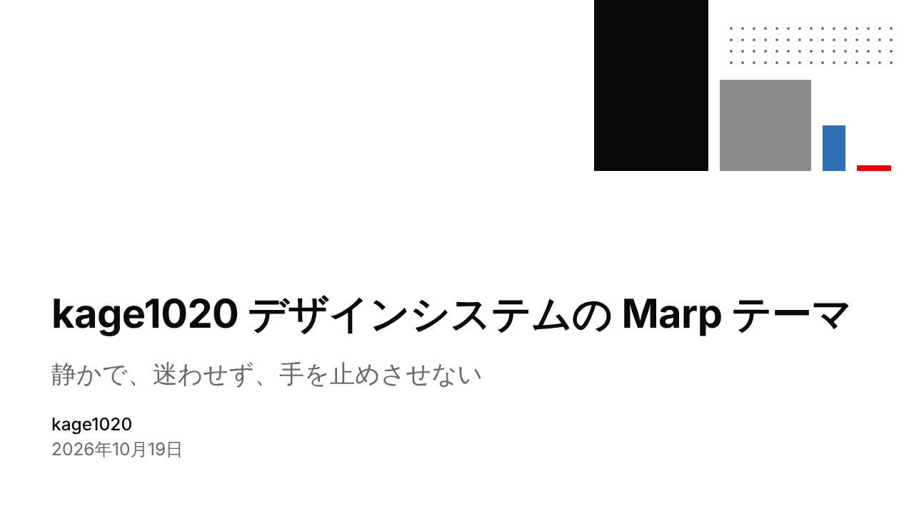
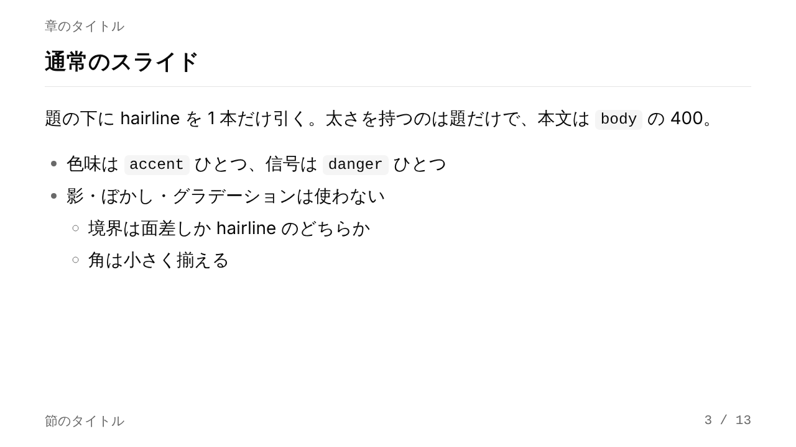
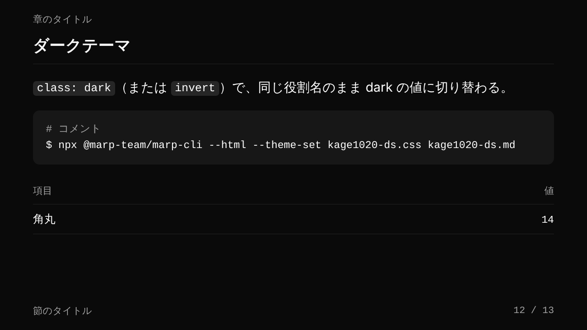

# marp-theme

my customized marp theme

## Usage

use `.vscode/settings.json` to set the theme

```json
{
  "markdown.marp.themes": [
    "https://raw.githubusercontent.com/kage1020/marp-theme/main/kage1020.css",
    "https://raw.githubusercontent.com/kage1020/marp-theme/main/kage1020-academic.css",
    "https://raw.githubusercontent.com/kage1020/marp-theme/main/claude-code.css",
    "https://raw.githubusercontent.com/kage1020/marp-theme/main/kage1020-ds.css"
  ]
}
```

then, set frontmatter in markdown file

```markdown
---
marp: true
theme: kage1020
---
```

## Preview

### cover slide

```markdown
<!--
_class: cover
-->
```


### appendix slide

```markdown
---
_class: appendix
---
```


### default slide

```markdown
---
<!--
header: Title for Chapter
footer: Sub Title for Sub Chapter
paginate: true
-->
```


### with image alignment

#### centering

```markdown

```


#### right aligned

```markdown

```


### table

```markdown
| header1 | header2 | header3 |
| ------- | ------- | ------- |
| cell1   | cell2   | cell3   |
| cell4   | cell5   | cell6   |
| cell7   | cell8   | cell9   |
```


### Color code

```markdown
<code class="color" style="--color: red">red</code>
```


## Blockquote and Citation

```markdown
> Lorem ipsum dolor sit amet, consectetur adipiscing elit. Integer posuere erat a ante.
<cite class="center">Someone famous in Source Title</cite>
```


### arrow

```markdown
<p class="before-right-arrow">Lorem ipsum dolor sit, amet consectetur adipisicing elit. Atque eaque beatae quas facere ut blanditiis nisi sint laudantium, possimus nobis sed iste commodi praesentium eveniet assumenda porro esse omnis, repellat itaque totam, quisquam facilis voluptatem consequuntur corrupti! Tenetur distinctio atque quisquam nihil? Dignissimos quibusdam obcaecati nam odio consequatur recusandae ex.</p>
```


## claude-code theme

A dark theme inspired by the Claude Code CLI.

```markdown
---
marp: true
theme: claude-code
paginate: true
header: Chapter Title
footer: Sub Title
---
```

### layout

- top left: a character (`--cc-character`) and its one-line comment (`.comment`)
- top right: `header`
- center: slide contents
- bottom: a prompt box filled with the `#` heading of the slide
- bottom left: `footer`
- bottom right: page number


### cover slide

```markdown
<!--
_class: cover
-->

# Title

## Subtitle

Author / Date
```


### divider slide

Written as a slash command. Use `##` instead of `#` on this class.

```markdown
<!--
_class: divider
-->

## getting-started
```


### character comment

```markdown
<p class="comment">a one-line comment</p>
<p class="comment thinking">thinking...</p>
```

### agent log style

```markdown
<p class="tool">Read(slides.md)</p>
<p class="result">Read 128 lines</p>
<p class="result"><span class="added">+ 12 lines</span> / <span class="removed">- 3 lines</span></p>
```


### classes

| class                | description                                  |
| -------------------- | -------------------------------------------- |
| `_class: cover`      | cover slide                                  |
| `_class: divider`    | section divider slide                        |
| `_class: middle`     | align the contents to the vertical center    |
| `.comment`           | speech balloon of the character              |
| `.comment.thinking`  | dashed and dimmed balloon                    |
| `.tool`              | tool call line                               |
| `.result`            | tool result line                             |
| `.added` / `.removed`| green / red text                             |
| `.dim` / `.accent`   | dimmed / accent colored text                 |
| `.center` / `.right` | text alignment                               |

Image alignment (`![center]` / `![right]`) works as same as the `kage1020` theme.
Marp background images (`![bg]`, `![bg left:40%]`) are also usable. The content
frame is hidden on the slides using a split background image.

### customize

Every color and metric is a CSS variable, so it can be overridden per deck or per slide.

```markdown
<style>
section {
  --cc-character: url("./avatar.png");
  --cc-character-size: 64px;
  --cc-accent: #d97757;
  --cc-bg: #1f1e1d;
}
</style>
```

| variable                | default   | description                        |
| ----------------------- | --------- | ---------------------------------- |
| `--cc-character`        | asterisk  | image of the character (`none` to hide) |
| `--cc-character-size`   | `56px`    | size of the character              |
| `--cc-bg`               | `#1f1e1d` | slide background                   |
| `--cc-panel`            | `#262624` | prompt box background              |
| `--cc-panel-alt`        | `#302f2c` | balloon / code background          |
| `--cc-border`           | `#3d3b37` | border of the content frame        |
| `--cc-fg`               | `#e8e6df` | text color                         |
| `--cc-dim`              | `#8d887e` | header, footer and page number     |
| `--cc-accent`           | `#d97757` | accent color                       |
| `--cc-gutter`           | `40px`    | horizontal margin of the frame     |
| `--cc-frame-top`        | `94px`    | top position of the content frame  |
| `--cc-frame-bottom`     | `150px`   | bottom position of the content frame |

## kage1020-ds

A theme that follows the kage1020 design system: near-monochrome, one accent hue (`accent`), one signal hue (`danger`), no shadows or gradients, and boundaries drawn either by a surface difference (`bg-subtle`) or a 1px hairline (`line`). Colors are the design system tokens as-is; type, spacing and radii are scaled ×1.75 for slides (body 16px → 28px). Fonts are not loaded; the OS default `sans` / `mono` stacks are used.

```markdown
---
marp: true
theme: kage1020-ds
paginate: true
---
```

See [kage1020-ds.md](kage1020-ds.md) for every feature. HTML must be enabled (`--html` for Marp CLI, `markdown.marp.enableHtml` for VS Code) to use the `<div>`, `<cite>`, `<kbd>` and `<p class>` snippets below.





| Markdown | Result |
| --- | --- |
| `_class: cover` | Title slide with the design system's cover art (top right) |
| `_class: appendix` | Section divider on the `bg-subtle` surface |
| `_class: dark` (or `invert`) | Dark theme; combine as `_class: cover dark` |
| `header` / `footer` / `paginate` | `meta` text in `ink-muted`; page number as `3 / 13` in `mono` |
| `\| --: \|` (right-aligned column) | Treated as numbers: `mono` with tabular figures |
| `<th class="up">` / `<th class="down">` | Sort direction shown as `↑` / `↓` |
| `<div class="callout">` / `<div class="callout danger">` | The only two boxed containers: a group, or something that needs confirmation |
| `<kbd>⌘</kbd>` | Key hint |
| `<mark>` | Highlight on the referenced part of the source text |
| `<p class="meta">` / `<p class="caption">` | Supplementary text in `ink-muted` |
| `` / `` | Centered / right-floated image |
| `<code class="color" style="--color: #2d70b3">` | Color swatch |
| `<cite>` / `<cite class="center">` / `<cite class="right">` | Citation |


